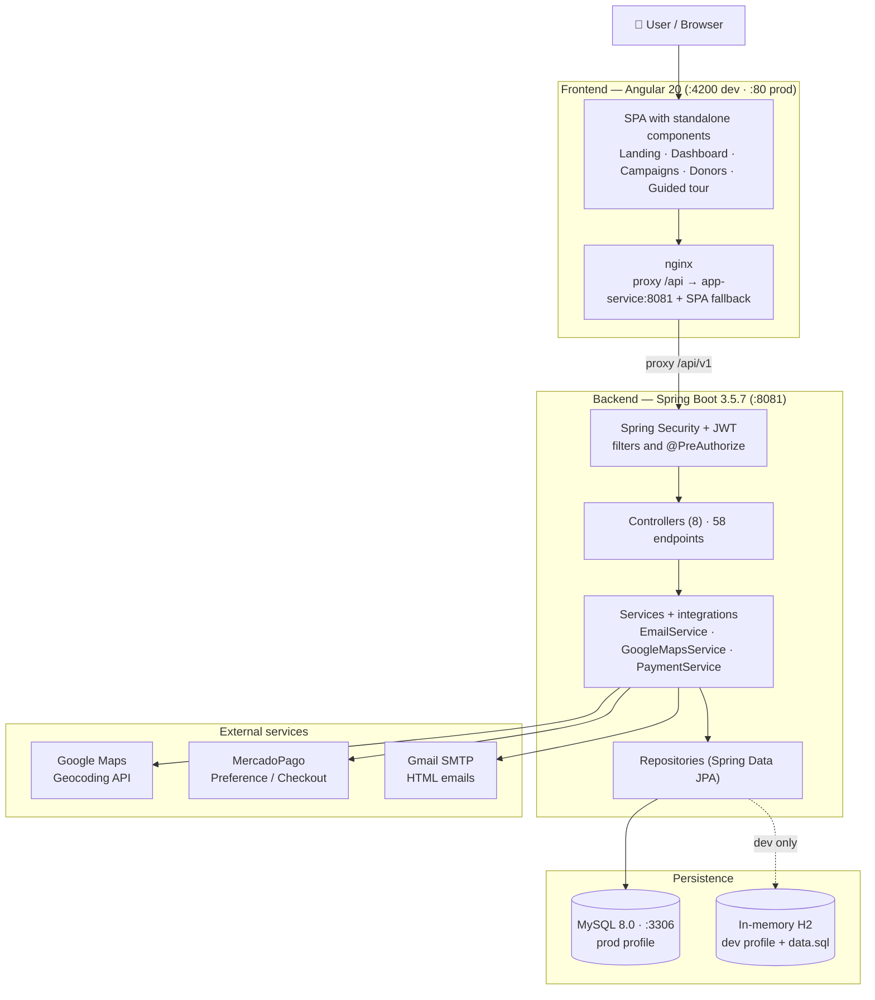
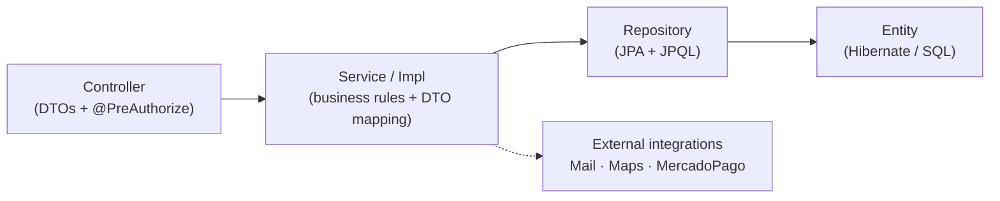
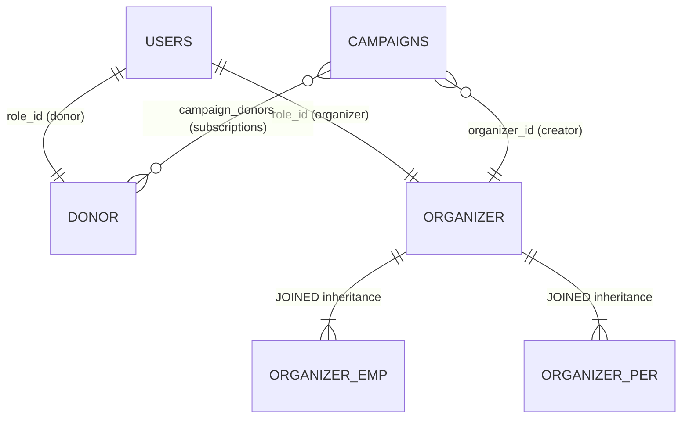

<p align="center">
  <a href="https://github.com/FedericoMartinFunesPalacio/Bloodo.net">
    
  </a>
</p>

<h1 align="center">🩸 Bloodo.net</h1>

<p align="center">
  <strong>A full stack platform to organize, promote and track blood donation campaigns.</strong>
</p>

<p align="center">
  <a href="./README.md">🇪🇸 Español</a>
  ·
  <a href="#-description">Description</a>
  ·
  <a href="#-architecture">Architecture</a>
  ·
  <a href="#-quick-start">Quick start</a>
  ·
  <a href="#-api-reference">API</a>
  ·
  <a href="#-testing--quality">Tests</a>
</p>

<p align="center">
  
  
  
  
  
  
  
  
  
</p>

> ⚠️ **Project finalized** — Bloodo.net is complete and **not under active development**. **All rights reserved** © 2026 Federico Martin Funes Palacio: no license is granted for use, modification or distribution to third parties. See [License and usage](#-license-and-usage).

---

> 🇪🇸 **Resumen en español:** Bloodo.net es una aplicación web full stack (Angular 20 + Spring Boot 3 + MySQL) para gestionar campañas de donación de sangre: los donadores exploran y se suscriben a campañas, los organizadores las crean y las miden con métricas (sangre estimada en litros, vidas salvadas, rankings por tipo sanguíneo, distribución geográfica) y el administrador gestiona la plataforma. Incluye autenticación JWT con roles (ADMIN / DONOR / ORGANIZER), notificaciones in-app y correos HTML, geocodificación con Google Maps, donaciones con MercadoPago, un tour guiado y 313 tests automatizados con cobertura JaCoCo. **[Leer el README completo en español →](./README.md)**

---

## 📌 Description

**Bloodo.net** is a **full stack** web application that connects **blood donors** with **campaign organizers** (hospitals, foundations, the Red Cross, or individual organizers) and a platform **administrator**.

The problem it solves: blood donation campaigns are hard to promote and hard to track. Bloodo.net centralizes campaign publishing, donor subscriptions, automatic communication (email + in-app notifications) and the measurement of real impact in lives saved and liters of blood collected.

### 🎯 Goals

- ✅ **Publish donation campaigns** with a real location (geocoded through Google Maps) and blood group/factor requirements.
- ✅ **Match donors** with the campaigns that fit their blood type.
- ✅ **Automate communication**: emails on campaign creation/update + in-app notifications.
- ✅ **Measure impact**: estimated blood (L), lives saved, blood-type rankings, geographic distribution and per-organizer metrics.
- ✅ **Fund the cause** through MercadoPago donations.
- ✅ **Clear, secure roles** (JWT + method-level authorization) for donors, organizers and administrators.

---

## ✨ Features

### 🔴 Donor
- **2-step registration** (credentials → donor profile with blood group/factor, height, weight, etc.).
- Browse and **search campaigns**, view details with an embedded **Google Maps** view, blood requirements and metrics.
- **Subscribe / unsubscribe** with blood-type compatibility checks and an **eligibility checklist** computed from their own data (weight ≥ 50 kg, age 18–65, time since last donation, tattoos, pregnancy…).
- **“My Donations” portal**: active subscriptions, stats (campaigns attended, estimated ml/L) and a **health panel** (BMI, age, next eligible donation date).
- Receives **in-app notifications** and **emails** for new campaigns matching their blood type.

### 🏥 Organizer *(Company or Person)*
- **Campaign CRUD**: create, edit, finish (with an end date) and delete (soft delete).
- View **subscribed donors** with contact information.
- **Own metrics panel**: estimated blood, lives saved, % by blood type (pie chart), geographic distribution, finished vs. total campaigns and average donors per campaign.
- On create/edit: **automatic geocoding**, bulk emails and in-app notifications.
- **“Upcoming” reminder** trigger (once, when the start date is ≤ 3 days away).

### 🛡️ Administrator
- All organizer capabilities over **any** campaign.
- **Full CRUD on donors and organizers** (company/person).
- **Global dashboard** with platform-wide metrics and recent campaigns.

### 🌍 Cross-cutting
- **Public landing page** with image carousel, stats and “How it works”.
- **Login / registration / password recovery** in 3 steps with an emailed code.
- **Notification bell** with unread counter and 30-second polling.
- **Interactive guided tour** (per route and per role, mobile version, 5-second progress bar).
- **FAQ modal** (12 Q&A), **toast** system, **confirmation dialogs** and an animated blood-drop loading spinner.
- **MercadoPago donations** (preset or custom amounts).
- **Terms & conditions**, **responsive** design (768 px breakpoint) and **Anime.js** animations.

---

## 🏗️ Architecture

**Client-server** architecture with an SPA served behind nginx, a stateless JWT-protected REST API and profile-based persistence (H2 in development, MySQL 8.0 in production).



### Backend layers



**Patterns applied:** interface + implementation for every service, manual DTO ⇄ entity mapping, constructor injection (IoC), Lombok (`@Data`, `@RequiredArgsConstructor`, `@Builder`), soft delete via `isActive`, `JOINED` inheritance for organizers and centralized error handling with `@ControllerAdvice`.

### Authentication flow

```mermaid
sequenceDiagram
    actor U as User
    participant FE as Angular SPA
    participant API as Spring Boot
    participant DB as MySQL / H2

    U->>FE: Registration (credentials + role + profile)
    FE->>API: POST /api/v1/donors/auth
    API->>DB: Creates donor profile
    API-->>FE: profile id (roleId)
    FE->>API: POST /api/v1/auth/register
    API->>DB: User with BCrypt password
    API-->>FE: Registration OK
    U->>FE: Login
    FE->>API: POST /api/v1/auth/login
    API-->>FE: JWT (1 h) + role + roleId
    FE->>FE: Stores token and user in localStorage
    loop Every protected request
        FE->>API: Authorization: Bearer &lt;jwt&gt;
        API-->>FE: 200 OK · 401 · 403
    end
```

---

## 🛠️ Tech stack

### Frontend
| Technology | Version | Usage |
|---|---|---|
| Angular | **20.3** | 100 % *standalone components* SPA, no `NgModule` |
| TypeScript | 5.9 | `strict: true` + `strictTemplates` |
| Angular Material / CDK | 20.2 | Iconography (100+ `mat-icon`) and demo CRUD widgets |
| RxJS | 7.8 | `BehaviorSubject`, `forkJoin`, `takeUntil` in services and guards |
| Anime.js | 4.4 | Entrance animations, *scroll reveal* and counters |
| ngx-guided-tour-lite | 0.2 | Route/role-aware guided tour with progress bar |
| Hand-written CSS + design tokens | — | `styles/variables.css` (blue `#2563eb` + blood red `#dc2626`) |
| Karma / Jasmine | — | Unit testing setup (`npm test`) |
| Prettier | — | Formatting with the `angular` parser for HTML |

> **Design note:** the project uses **hand-written CSS with design tokens** (a hard requirement of the project spec: *“CSS only, no tailwind”*). Tailwind is installed but **intentionally not activated** (no `@tailwind` directives).

### Backend
| Technology | Version | Usage |
|---|---|---|
| Spring Boot | **3.5.7** | REST API + `@EnableAsync` for emails |
| Java | 17 | Service language |
| Spring Security + JJWT | 0.11.5 | Stateless **JWT authentication (HS256, 1 h)** |
| Spring Data JPA / Hibernate | — | Persistence, JPQL queries and aggregate metrics |
| MySQL Connector / H2 | 8.0 / — | MySQL in prod, **in-memory H2 in dev** |
| springdoc-openapi | 2.1.0 | **Swagger UI** documentation |
| JavaMailSender | — | HTML emails (welcome, password reset, campaigns) |
| MercadoPago SDK Java | 2.1.9 | Donation preference creation |
| Lombok + Jakarta Validation | — | Boilerplate reduction and validation |
| JaCoCo | 0.8.12 | Test coverage reports |

### Infrastructure
| Technology | Usage |
|---|---|
| Docker + Docker Compose | Orchestrates `mysql`, `app-service` and `frontend` |
| nginx | SPA serving + `/api` reverse proxy (no CORS in prod) |
| Multi-stage builds | `maven:3.9.6` → `temurin:17-jre` (BE) · `node:20` → `nginx` (FE) |
| Environment variables | `.env` (gitignored) + `java-dotenv` for keys and credentials |

---

## 📁 Project structure

```
Bloodo.net/
├── docker-compose.yml            # mysql + backend + frontend
├── README.md
├── backend/
│   └── app-service/
│       ├── pom.xml               # Spring Boot 3.5.7 · Java 17 · JaCoCo
│       ├── Dockerfile            # multi-stage Maven → JRE 17
│       └── src/
│           ├── main/java/com/FedericoFunes/app_service/
│           │   ├── controllers/  # Auth · Campaigns · Donor · Organizer(Emp/Per)
│           │   │                # Notification · Payment · Dummy  → 8 controllers
│           │   ├── services/     # interfaces + impl/ (7) + external/ (Email, GoogleMaps, Payment)
│           │   ├── dtos/         # Request/Response per module (campaigns, donor, users…)
│           │   ├── entities/     # Users · Donor · Organizer(+Emp/Per) · Campaigns · Notification
│           │   │   └── enums/    # BloodGroup · BloodFactor · Gender · Roles
│           │   ├── repositories/ # 7 repositories (JPA + JPQL)
│           │   ├── security/     # SecurityConfig · JwtUtil · JwtAuthenticationFilter · Dotenv
│           │   └── handlers/     # GlobalExceptionHandler + custom exceptions
│           ├── main/resources/
│           │   ├── application.properties        # base + JWT + mail + MercadoPago
│           │   ├── application-dev.properties    # H2 + /h2-console + seed data
│           │   ├── application-prod.properties   # MySQL
│           │   └── data.sql                      # test data (dev only)
│           └── test/java/        # 18 files · 313 tests
└── frontend/
    ├── package.json · angular.json · tailwind.config.js
    ├── Dockerfile · nginx.conf
    └── src/
        ├── app/
        │   ├── pages/            # landing · home (dashboard) · demo CRUD
        │   ├── components/
        │   │   ├── campaign/     # list · detail · form · my-campaigns
        │   │   ├── donor/        # form · list · my-donations
        │   │   ├── organizer/    # form · list (company/person)
        │   │   ├── loginSecurity/# auth · forgot-password
        │   │   └── reusable/     # navbar · footer · notification-bell · toast
        │   │                     # confirm-dialog · donate-modal · faq · loading · tour…
        │   ├── services/         # 12 services (HttpClient + Observables)
        │   ├── models/           # domain interfaces and enums
        │   ├── guards/           # AuthGuard · RoleGuard
        │   ├── pipes/ utils/     # enumLabel · dates · validators · dto-mapper
        │   └── app.routes.ts     # route table + guards
        ├── styles/variables.css  # design system (tokens)
        └── custom-theme.scss     # Angular Material 3 theme
```

<details>
<summary><strong>Code count (lines)</strong></summary>

| Part | Files | Lines |
|---|---:|---:|
| Backend `src/main` (Java) | 81 | ~4,510 |
| Backend `src/test` (Java) | 18 | ~4,945 |
| Frontend TypeScript | — | ~5,491 |
| Frontend HTML | — | ~2,552 |
| Frontend CSS/SCSS | — | ~6,287 |

</details>

---

## 🚀 Quick start

### Requirements

**Option A — Docker (recommended):**
- Docker + Docker Compose

**Option B — Local development:**
- **Java 17** + Maven (or the included `./mvnw` wrapper)
- **Node.js 20+** + npm
- *(no MySQL needed: the `dev` profile uses in-memory H2)*

### 1️⃣ Environment variables

Create the file **`backend/app-service/.env`** (it is in `.gitignore`, never committed):

```dotenv
# Google Maps (Geocoding) — used when creating campaigns and organizers
GOOGLE_MAPS_API_KEY=your_google_maps_api_key

# Gmail SMTP (requires a Google "app password")
SPRING_MAIL_USERNAME=your_email@gmail.com
SPRING_MAIL_PASSWORD=your_app_password

# MercadoPago (test mode)
MERCADOPAGO_ACCESS_TOKEN=TEST-0000000000000000-000000-00000000000000000000000000000000-000000000
```

> These 4 keys are **required** for the backend to boot (they are resolved as Spring placeholders).

### 2️⃣ Option A — Everything with Docker

```bash
git clone https://github.com/FedericoMartinFunesPalacio/Bloodo.net.git
cd Bloodo.net
# create backend/app-service/.env (step 1)
docker compose up --build
```

| Service | URL |
|---|---|
| 🌐 Frontend (Angular + nginx) | http://localhost |
| ⚙️ Backend API | http://localhost:8081 |
| 🗄️ MySQL 8.0 | `localhost:3306` (db `bloodonet`, user `root` / `root`) |

> **Important:** Docker runs the **`prod`** profile (MySQL), where `spring.sql.init.mode=never`: the database **starts empty**. Register through the UI as a donor or organizer (no admin user is preloaded).

### 3️⃣ Option B — Local development (`dev` profile + H2)

```bash
# Terminal 1 — Backend (default dev profile: in-memory H2 + data.sql)
cd backend/app-service
./mvnw spring-boot:run
# → http://localhost:8081

# Terminal 2 — Frontend (proxy /api → :8081)
cd frontend
npm install
npm start
# → http://localhost:4200
```

| Resource | URL |
|---|---|
| 🌐 App (dev server) | http://localhost:4200 |
| ⚙️ API | http://localhost:8081/api/v1 |
| 🗄️ H2 console | http://localhost:8081/h2-console *(JDBC URL: `jdbc:h2:mem:testdb`, user `sa`, empty password)* |
| 📚 Swagger UI | http://localhost:8081/swagger-ui/index.html |

### 4️⃣ Test users *(`dev` profile only)*

`data.sql` seeds **10 users**, **30 donors**, **13 organizers** and **59 campaigns** (active, finished and subscriptions). Shared password: **`password123`**.

| User | Role | Profile | Description |
|---|---|---|---|
| `admin` | 🛡️ ADMIN | — | Global administration panel |
| `FedeDon` | 🔴 DONOR | donor `148` | Fully seeded donor with subscriptions |
| `DrFede` | 🏥 ORGANIZER | organizer `149` | Organizer with own campaigns |
| `hosp_italiano` | 🏥 ORGANIZER | organizer `103` | Hospital Italiano de Córdoba |
| `fund_sangre` | 🏥 ORGANIZER | organizer `104` | Fundación Sangre |
| `cr_cordoba` | 🏥 ORGANIZER | organizer `105` | Red Cross Córdoba |
| `lucia_fer` | 🏥 ORGANIZER | organizer `108` | Person organizer |
| `marcos_lo` | 🏥 ORGANIZER | organizer `109` | Person organizer |
| `mateo_d` | 🔴 DONOR | donor `110` | Test donor |
| `isabella_m` | 🔴 DONOR | donor `111` | Test donor |

---

## 🔐 Authentication & roles

- **Scheme:** stateless **JWT** (HS256) with a **1-hour** expiry (`jwt.expiration=3600000`), issued by `POST /api/v1/auth/login`.
- **Passwords:** **BCrypt** hashing (`BCryptPasswordEncoder`).
- **Transport:** `Authorization: Bearer <token>` header on every protected request.
- **Authorization:** `@EnableMethodSecurity` + `@PreAuthorize("hasAnyRole('ADMIN','DONOR','ORGANIZER')")` per endpoint.
- **Public endpoints:** `POST /api/v1/auth/**` and `POST /api/v1/{donors|organizer-emps|organizer-pers}/auth` (login, registration, reset). **Everything else requires a JWT.**
- **Roles:**

| Role | Create campaigns | Subscribe | Manage donors/organizers | Global metrics |
|---|:---:|:---:|:---:|:---:|
| 🔴 `DONOR` | — | ✅ | own profile only | — |
| 🏥 `ORGANIZER` | ✅ | — | own profile only | per organizer |
| 🛡️ `ADMIN` | ✅ (any) | — | ✅ | ✅ |

- **Client-side protection:** `AuthGuard` (session) and `RoleGuard` (session + role) in `app.routes.ts`; the token lives in `localStorage` (`authToken` + `currentUser`).
- **CORS:** controllers declare `@CrossOrigin("*")`; in production nginx proxies make requests *same-origin*, so CORS is not needed.
- **Secrets:** API keys and credentials live outside the repo (`.env` + environment variables).

---

## 📖 API reference

**Base URL (dev):** `http://localhost:8081/api/v1` · **Swagger UI:** `/swagger-ui/index.html` (springdoc 2.1.0)

```http
Authorization: Bearer <jwt>
Content-Type: application/json
```

**Conventions:**
- 🐍 **snake_case** in JSON payloads / **camelCase** in code.
- 📅 Dates as **`dd-MM-yyyy`** in DTOs (`yyyy-MM-dd` in query params and `type="date"` inputs).
- ❌ Errors shaped as `{ "code": …, "description": …, "timestamp": … }` through `GlobalExceptionHandler` → `400 Bad Request` · `401 Unauthorized` · `403 Forbidden` · `404 Not Found` · `500 Internal`.
- 🌐 = public (no token) · Roles: **A** = ADMIN, **D** = DONOR, **O** = ORGANIZER.

### 🔑 Auth — `/api/v1/auth` *(public)*

| Method | Path | Body | Response |
|---|---|---|---|
| `POST` | `/auth/register` | username, password, email, phone, role, role_id | `ResponseUsersDTO` |
| `POST` | `/auth/login` | username, password | `token`, `id`, `role`, `roleId`, `email`, `phone` |
| `POST` | `/auth/reset-request` | email | reset code |
| `POST` | `/auth/reset-password` | email, password | `true` |

### 🩸 Campaigns — `/api/v1/campaigns` *(26 endpoints)*

**Management**

| Method | Path | Roles | Description |
|---|---|---|---|
| `GET` | `/campaigns/` | A·D·O | Active, unfinished campaigns |
| `GET` | `/campaigns/{id}` | A·D·O | Details (404 if inactive or finished) |
| `GET` | `/campaigns/organizer/{organizerId}` | A·O | Campaigns of an organizer |
| `POST` | `/campaigns/` | A·O | Create (geocodes + emails + notifications) |
| `PUT` | `/campaigns/{id}` | A·O | Update (re-geocodes + notifies subscribers) |
| `DELETE` | `/campaigns/{id}` | A·O | Soft delete (`isActive=false`) |
| `PUT` | `/campaigns/{campaignId}/finish?endDate=yyyy-MM-dd` | A·O | Finish a campaign |
| `POST` | `/campaigns/{id}/notify-upcoming` | A·O | “Upcoming” reminder (≤ 3 days, once) |

**Subscriptions**

| Method | Path | Roles | Description |
|---|---|---|---|
| `POST` | `/campaigns/{campaignId}/subscribe` | D | Subscribe (duplicate blocked by document) |
| `DELETE` | `/campaigns/{campaignId}/unsubscribe` | D | Unsubscribe |
| `GET` | `/campaigns/subscribed/{campaignId}` | A·D·O | List of subscribed donors |
| `GET` | `/campaigns/subscribed-by/me` | D | My active subscriptions |
| `GET` | `/campaigns/finished` | A·D·O | Finished campaigns |

**Global metrics**

| Method | Path | Response |
|---|---|---|
| `GET` | `/campaigns/metrics/blood-estimated` | estimated blood per campaign (L) |
| `GET` | `/campaigns/metrics/blood-total` | total estimated blood + campaign count |
| `GET` | `/campaigns/metrics/blood-type-ranking/{campaignId}` | group/factor ranking of subscribers |
| `GET` | `/campaigns/metrics/lives-saved` | lives saved per campaign |
| `GET` | `/campaigns/metrics/lives-saved-total` | total lives saved + finished campaigns |

**Per-organizer metrics** *(A·O)*

| Method | Path | Response |
|---|---|---|
| `GET` | `/campaigns/metrics/organizer/{organizerId}/blood-total` | estimated blood (finished campaigns) |
| `GET` | `/campaigns/metrics/organizer/{organizerId}/blood-type-percentage` | % by blood type |
| `GET` | `/campaigns/metrics/organizer/{organizerId}/campaign-count` | number of campaigns |
| `GET` | `/campaigns/metrics/organizer/{organizerId}/finished-count` | finished count |
| `GET` | `/campaigns/metrics/organizer/{organizerId}/total-donors` | total subscriptions |
| `GET` | `/campaigns/metrics/organizer/{organizerId}/average-donors` | average donors per campaign |
| `GET` | `/campaigns/metrics/organizer/{organizerId}/lives-saved` | lives saved |
| `GET` | `/campaigns/metrics/organizer/{organizerId}/geographic-distribution` | addresses + lat/lng + status |

### 🔴 Donors — `/api/v1/donors` *(9 endpoints)*

| Method | Path | Roles | Description |
|---|---|---|---|
| `GET` | `/donors/` | A·D | List (active only) |
| `GET` | `/donors/{id}` | A·D | Details |
| `POST` | `/donors/auth` | 🌐 | Create profile (registration, step 2) |
| `PUT` | `/donors/{id}` | A·D | Update profile |
| `DELETE` | `/donors/{id}` | A·D | Soft delete |
| `GET` | `/donors/me/metrics/stats` | D | Campaigns attended, estimated ml and liters |
| `GET` | `/donors/me/metrics/health` | D | Blood type, age, BMI, last/next donation |
| `GET` | `/donors/metrics/blood-type-ranking` | A·D·O | Global ranking by blood type |
| `GET` | `/donors/metrics/blood-type-percentage` | A·D·O | % of donors by blood type |

### 🏥 Organizers — `/api/v1/organizer-emps` and `/api/v1/organizer-pers` *(10 endpoints)*

Both modules expose the same CRUD (company = `fullName` · person = names + birthdate + gender):

| Method | Path | Roles |
|---|---|---|
| `GET` | `/organizer-emps/` · `/organizer-pers/` | A·O |
| `GET` | `/organizer-emps/{id}` · `/organizer-pers/{id}` | A·O |
| `POST` | `/organizer-emps/auth` · `/organizer-pers/auth` | 🌐 (geocodes the address) |
| `PUT` | `/organizer-emps/{id}` · `/organizer-pers/{id}` | A·O |
| `DELETE` | `/organizer-emps/{id}` · `/organizer-pers/{id}` | A·O |

### 🔔 Notifications — `/api/v1/notifications` *(4 endpoints · A·D·O)*

| Method | Path | Description |
|---|---|---|
| `GET` | `/notifications` | Unread notifications (newest first) |
| `GET` | `/notifications/unread-count` | Unread counter |
| `PUT` | `/notifications/{id}/read` | Mark one as read |
| `PUT` | `/notifications/read-all` | Mark all as read |

### 💳 Payments — `/api/v1/payments` *(1 endpoint · A·D·O)*

| Method | Path | Body | Response |
|---|---|---|---|
| `POST` | `/payments/donate` | `{"amount": 1000}` | MercadoPago checkout URL (`initPoint`) |

<details>
<summary><strong>🧪 Dummy — CRUD demo module</strong> <code>/api/v1/dummy</code></summary>

| Method | Path | Description |
|---|---|---|
| `GET` | `/dummy` | List |
| `GET` | `/dummy/{id}` | Details |
| `POST` | `/dummy` | Create |
| `PUT` | `/dummy/{id}` | Update |

Practice module (Material table + form) consumed by the `/dummy` route.

</details>

---

## 🗄️ Data model



### Enums

| Enum | Values |
|---|---|
| `BloodGroup` | `A` · `B` · `AB` · `O` |
| `BloodFactor` | `POSITIVE` · `NEGATIVE` |
| `Gender` | `MALE` · `FEMALE` · `OTHER` |
| `Roles` | `ADMIN` · `DONOR` · `ORGANIZER` |

### Main entities

| Entity | Key fields | Relationships |
|---|---|---|
| **`UsersEntity`** | username, password (BCrypt), email (unique), phone, **role**, **roleId** (profile pointer), isActive | implements `UserDetails` |
| **`DonorEntity`** | firstName, lastName, birthdate, document, bloodGroup, bloodFactor, gender, height (m), weight (kg), email, phone, isActive | `campaign_donors` |
| **`Organizer`** *(abstract)* | document (CUIT/DNI), direction, latitude, longitude, email, phone, isActive | base of `Emp` / `Per` |
| **`OrganizerEmpEntity`** | fullName | `@Inheritance(JOINED)` |
| **`OrganizerPerEntity`** | firstName, lastName, birthdate, gender | `@Inheritance(JOINED)` |
| **`CampaignsEntity`** | title, description, startDate, endDate, startTime, direction, lat/lng, bloodGroupRequired, bloodFactorRequired, wasNotify, isActive | `@ManyToOne` → Organizer · `@ManyToMany` → Donors |
| **`NotificationEntity`** | userId, title, message, isRead, createdAt | — |

> **Soft delete:** donors, organizers and campaigns use `isActive` instead of a physical `DELETE`.

---

## 📊 Business rules & metrics

| Rule | Calculation |
|---|---|
| 🩸 **Estimated blood** | subscribers × **450 ml** (÷ 1000 → liters) |
| 💚 **Lives saved** | subscribers × **3** (one donation can save up to 3 lives) |
| 📅 **Next eligible donation** | last finished campaign **+ 3 months** |
| ⚖️ **BMI** | `weight (kg) / height (m)²` with category and color in the health panel |
| ✅ **Eligibility checklist** | weight ≥ 50 kg · age 18–65 · **90 days** (women) / **60 days** (men) since last donation · tattoos/piercings 6 months · antibiotics 15 days · pregnancy 6 months |
| 📌 **Active campaign** | `isActive = true` **and** `endDate IS NULL` |
| 🔒 **Finished campaign** | cannot be edited, deleted or finished again |
| 🔔 **“Upcoming” reminder** | fired once (`wasNotify`), when the start date is ≤ 3 days away |
| ✉️ **Email filtering** | on campaign creation, only donors whose group/factor matches the requirement are notified |
| 🚫 **Duplicate subscription** | blocked by the donor's `document` |
| 🌍 **Geocoding** | addresses are converted to lat/lng with Google Maps on campaign/organizer create & update |

---

## 🎨 Frontend

### Architecture decisions
- **100 % standalone components** and the **new control flow** (`@if`, `@else`, `@for … track`) — no legacy `NgIf`/`NgFor`.
- **Template-driven forms** (`[(ngModel)]`) with custom validators in `utils/validators.ts`.
- **Services with `HttpClient` + Observables** (RxJS): `BehaviorSubject` for global state (user, toasts, FAQ, unread counter), `forkJoin` for parallel dashboard loads and `takeUntil` for unsubscriptions.
- **DTO mapping** snake_case ⇄ camelCase through the generic helper in `utils/dto-mapper.ts`.
- **Guards:** `AuthGuard` (session) and `RoleGuard` (role) with `data.roles` on the route definition.
- **No interceptors:** every service builds the header with `AuthService.getAuthHeaders()`.

### User experience
| Feature | Details |
|---|---|
| 🎬 Animations | Anime.js on the landing (hero + *scroll reveal*), dashboard, tables and metrics (bars, elastic heart, filling blood drop) |
| 🧭 Guided tour | Per route and role, desktop/mobile steps, 5 s auto-advance with progress bar, “?” button in the navbar |
| 🔔 Notifications | Bell with badge, 30-second polling, mark one/all as read, relative timestamps in Spanish |
| 🍞 Toasts + confirmations | 4 toast types and `Promise<boolean>` dialogs for destructive actions |
| 💳 Donation | Modal with $500/$1000/$2000/$5000 preset or custom amounts → MercadoPago |
| 🗺️ Google Maps | Embedded map with marker on the campaign detail + external links |
| 📱 Responsive | 768 px breakpoint on main components, hamburger menu, tables → cards |
| 🎨 Design system | `variables.css` with tokens (blue `#2563eb`, blood red `#dc2626`, Roboto, spacing/radius/shadow scales) |
| 🩸 Branding | Animated SVG blood-drop loading, hero carousel, `conic-gradient` pie chart |

### Main routes

| Route | Component | Guard |
|---|---|---|
| `/` | Landing (public) | — |
| `/auth` · `/forgot-password` | Login/Registration · Password reset | — |
| `/home` | Role-based dashboard | `AuthGuard` |
| `/campaigns` · `/campaigns/:id` | List · Detail | `AuthGuard` |
| `/campaigns/new` · `/campaigns/:id/edit` | Campaign form | `RoleGuard: ADMIN, ORGANIZER` |
| `/my-campaigns` | Organizer management + metrics | `RoleGuard: ADMIN, ORGANIZER` |
| `/my-donations` | Donor portal | `RoleGuard: DONOR` |
| `/donors` · `/donors/:id/edit` | Donor CRUD | `AuthGuard` |
| `/organizers` · `/organizers/:type/:id/edit` | Organizer CRUD | `AuthGuard` |
| `/terms-and-conditions` | Terms & conditions | — |
| `**` | Redirect to `/` | — |

---

## 🧪 Testing & quality

### Backend — **313 tests** across 18 files
| Type | Tools | Coverage |
|---|---|---|
| Service unit tests | **JUnit 5 + Mockito** (`@Mock` / `@InjectMocks`) | 233 tests: campaigns (81), donors (48), organizers, users, emails, Google Maps, payments |
| Controller slices | **`@WebMvcTest` + MockMvc** (shared `BaseControllerTest`) | 79 tests: auth, campaigns, donors, organizers, payments, dummy |
| Context | `@SpringBootTest` (`contextLoads`) | 1 test |

- **Coverage:** **JaCoCo 0.8.12** plugin (`prepare-agent` + `report`), target of **80 %**.
- Covered cases: happy paths plus 400/404/500 branches (campaign lifecycle, duplicate subscription, field-by-field validation, geocoding and Google Maps failures, email filtering, BCrypt and reset codes, MercadoPago `initPoint`).

```bash
cd backend/app-service
./mvnw test
# Report → target/site/jacoco/index.html
```

### Frontend
- **Karma + Jasmine** configured (`npm test`).
- Frontend spec coverage remained limited (see [final notes](#-final-notes)).

---

## 🐳 Docker

`docker-compose.yml` orchestrates 3 services on the `backend-net` network:

| Service | Image / build | Port | Notes |
|---|---|---|---|
| `mysql` | `mysql:8.0` | `3306` | db `bloodonet`, `db_data` volume, **healthcheck** |
| `app-service` | `backend/app-service/Dockerfile` | `8081` | `prod` profile, waits for MySQL *healthy*, reads `.env` |
| `frontend` | `frontend/Dockerfile` | `80` | nginx: Angular build + `/api` reverse proxy |

**Backend (multi-stage):** `maven:3.9.6-eclipse-temurin-17` (build) → `eclipse-temurin:17-jre-alpine` (runtime).
**Frontend (multi-stage):** `node:20-alpine` (`npm ci` + `ng build`) → `nginx:stable-alpine` with `nginx.conf` (SPA fallback + proxy to `app-service:8081`).

```bash
docker compose up --build      # start
docker compose down            # stop
docker compose down -v         # stop and wipe the database
```

---

## 📝 Final notes

> **Bloodo.net is finalized.** Development has concluded and the project will not evolve further. The points below are **improvement areas identified during the project**, documented as technical reference — **not planned enhancements nor open requests**.

- **Central HTTP interceptor** + JWT expiry/refresh handling (today every service builds the header and there is no automatic 401 handling).
- **Reset-code verification** on the backend (it is generated and emailed, but step two never validates it).
- **CI/CD with GitHub Actions**: build + `mvn test` + JaCoCo + `ng build` on every PR.
- **MercadoPago webhooks** and donation persistence.
- **Push notifications** and email digests.
- **i18n** (ES/EN) and **accessibility** improvements (`aria-*`, `alt`, `lang`).
- **E2E tests** (Playwright/Cypress) and a broader frontend spec suite.
- Expose **Swagger** through a public matcher with a documented security scheme.

---

## ⚖️ License and usage

This repository is published as **academic reference work**, in a finalized state.

- **All rights reserved** © 2026 Federico Martin Funes Palacio.
- **No license of any kind is granted for use, modification, reproduction or distribution** to third parties: the code is **not** released under an open-source license (MIT, GPL, Apache, etc.).
- **No contributions are accepted**: *pull requests* and development issues are not reviewed; the repository is closed to changes.
- Only **viewing and reading** the project on GitHub for reference purposes is permitted. Any use of the code requires the author's express permission.

---

## 👤 Author

**Federico Martin Funes Palacio**
GitHub: [FedericoMartinFunesPalacio](https://github.com/FedericoMartinFunesPalacio)

---

<p align="center">
  <sub>🩸 <strong>Bloodo.net</strong> — every drop counts.</sub>
</p>
