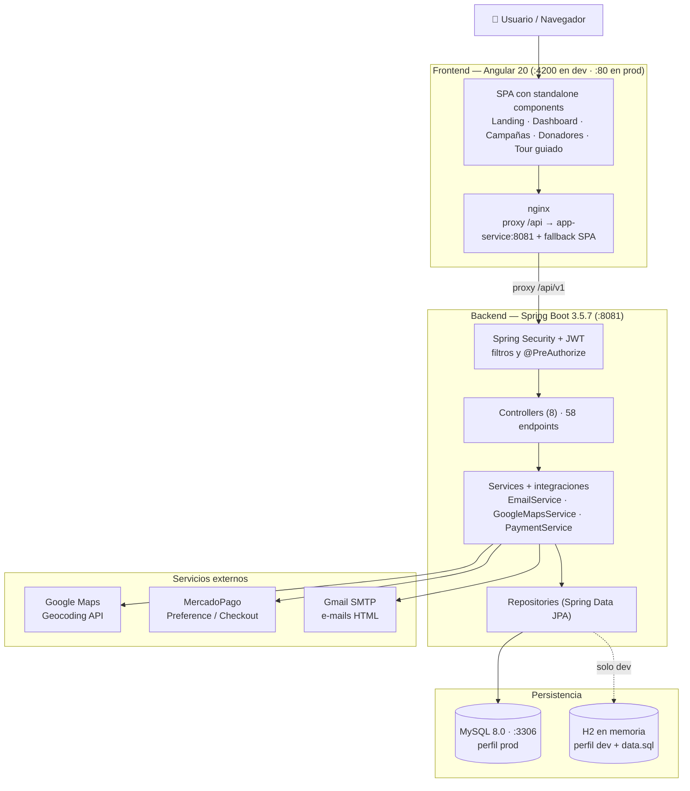
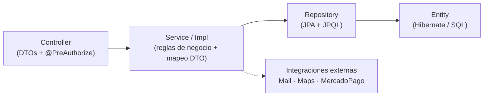
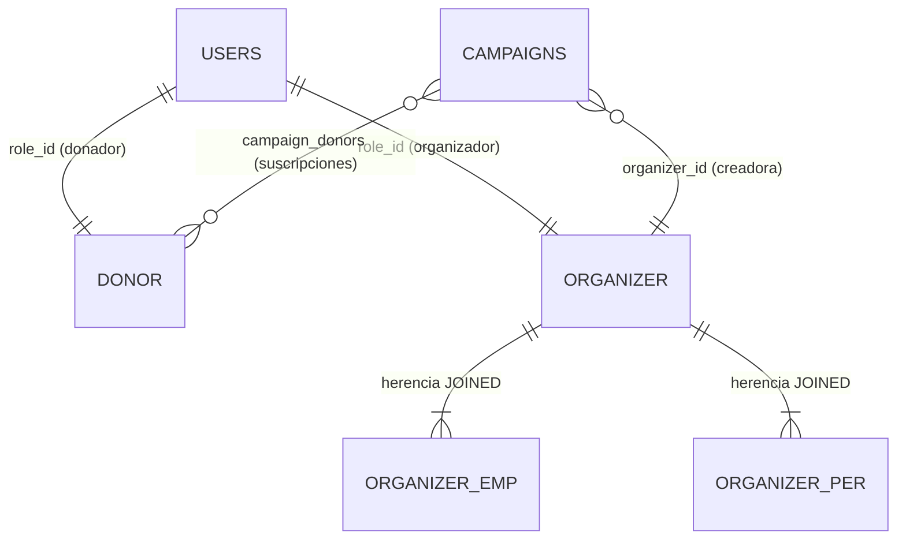

<p align="center">
  <a href="https://github.com/FedericoMartinFunesPalacio/Bloodo.net">
    
  </a>
</p>

<h1 align="center">🩸 Bloodo.net</h1>

<p align="center">
  <strong>Plataforma full stack para organizar, promocionar y seguir campañas de donación de sangre.</strong>
</p>

<p align="center">
  <a href="./README.en.md">🇬🇧 English</a>
  ·
  <a href="#-descripción">Descripción</a>
  ·
  <a href="#-arquitectura">Arquitectura</a>
  ·
  <a href="#-inicio-rápido">Inicio rápido</a>
  ·
  <a href="#-referencia-de-la-api">API</a>
  ·
  <a href="#-tests-y-calidad">Tests</a>
</p>

<p align="center">
  
  
  
  
  
  
  
  
  
</p>

> ⚠️ **Proyecto finalizado** — Bloodo.net está completado y **no está en desarrollo activo**. **Todos los derechos reservados** © 2026 Federico Martín Funes Palacio: no se otorga licencia de uso, modificación ni distribución a terceros. Ver [Licencia y uso](#-licencia-y-uso).

---

> 🇬🇧 **English summary:** Bloodo.net is a full stack web application (Angular 20 + Spring Boot 3 + MySQL) to manage blood-donation campaigns: donors browse and subscribe to campaigns, organizers create and track them with metrics (estimated blood in liters, lives saved, blood-type rankings, geographic distribution), and admins manage the whole platform. It features JWT authentication with role-based access (ADMIN / DONOR / ORGANIZER), in-app notifications and HTML emails, Google Maps geocoding, MercadoPago donations, a guided product tour, and 313 automated tests with JaCoCo coverage. **[Read the full English README →](./README.en.md)**

---

## 📌 Descripción

**Bloodo.net** es una aplicación web **full stack** que conecta a **donadores de sangre** con **organizadores de campañas** (hospitales, fundaciones, Cruz Roja, o personas organizadoras) y con un **administrador** de la plataforma.

El problema que resuelve: las campañas de donación son difíciles de promocionar y de seguir. Bloodo.net centraliza la publicación de campañas, la suscripción de donadores, la comunicación automática (e-mail + notificaciones in-app) y la medición del impacto real en vidas salvadas y litros de sangre recaudados.

### 🎯 Objetivos

- ✅ **Publicar campañas** de donación con ubicación real (geocodificada con Google Maps) y requisitos de grupo/factor sanguíneo.
- ✅ **Conectar donadores** con las campañas que les corresponden según su tipo de sangre.
- ✅ **Automatizar la comunicación**: e-mails al crear/actualizar/avanzar una campaña + notificaciones dentro de la app.
- ✅ **Medir el impacto**: sangre estimada (L), vidas salvadas, rankings por tipo sanguíneo, distribución geográfica y métricas por organizador.
- ✅ **Financiar la causa** con donaciones vía MercadoPago.
- ✅ **Roles claros** y seguros (JWT + autorización por método) para donadores, organizadores y administradores.

---

## ✨ Características

### 🔴 Donador
- Registro en **2 pasos** (credenciales → perfil de donador con grupo/factor sanguíneo, peso, altura, etc.).
- Explorar y **buscar campañas**, ver detalle con **mapa de Google Maps**, requisitos de sangre y métricas.
- **Suscribirse / desuscribirse** con validación de compatibilidad de tipo sanguíneo y **checklist de elegibilidad** calculado con sus propios datos (peso ≥ 50 kg, edad 18–65, tiempo desde la última donación, tatuajes, embarazo…).
- Portal **“Mis Donaciones”**: suscripciones activas, estadísticas (campañas asistidas, ml/L estimados) y **panel de salud** (IMC, edad, próxima fecha habilitada para donar).
- Recibe **notificaciones in-app** y **e-mails** de nuevas campañas que coinciden con su tipo de sangre.

### 🏥 Organizador *(Empresa o Persona)*
- **ABM de campañas**: crear, editar, finalizar (con fecha de cierre) y borrar (borrado lógico).
- Visualización de los **donadores suscriptos** con datos de contacto.
- **Panel de métricas propio**: sangre estimada, vidas salvadas, % por tipo sanguíneo (gráfico torta), distribución geográfica, campañas finalizadas vs. totales y promedio de donadores.
- Al crear/editar una campaña: **geocodificación automática**, envío de e-mails y creación de notificaciones in-app.
- Disparador de **aviso “próxima a comenzar”** (una sola vez, cuando faltan ≤ 3 días).

### 🛡️ Administrador
- Todas las funcionalidades de organizador sobre **cualquier** campaña.
- **ABM completo de donadores y organizadores** (empresa/persona).
- **Dashboard global** con métricas de la plataforma y campañas recientes.

### 🌍 Transversal
- **Landing pública** con carousel de imágenes, estadísticas y “¿Cómo funciona?”.
- **Login / registro / recuperación de contraseña** en 3 pasos con código por e-mail.
- **Campana de notificaciones** con contador de no leídas y *polling* cada 30 s.
- **Tour guiado** interactivo (por ruta y por rol, con versión mobile y barra de progreso de 5 s).
- **Modal de FAQ** (12 preguntas), sistema de **toasts**, **diálogos de confirmación** y *loading* con gota de sangre animada.
- **Donaciones con MercadoPago** (montos predefinidos o personalizados).
- **Términos y condiciones**, diseño **responsive** (breakpoint 768 px) y animaciones con **Anime.js**.

---

## 🏗️ Arquitectura

Arquitectura **cliente-servidor** con SPA desplegada detrás de nginx, API REST stateless con JWT y bases de datos según perfil (H2 en desarrollo, MySQL 8.0 en producción).



### Capas del backend



**Patrones aplicados:** interfaz + implementación en todos los servicios, mapeo manual DTO ⇄ entidad, inyección por constructor (IoC), Lombok (`@Data`, `@RequiredArgsConstructor`, `@Builder`), borrado lógico con `isActive`, herencia `JOINED` para organizadores y manejo centralizado de errores con `@ControllerAdvice`.

### Flujo de autenticación

```mermaid
sequenceDiagram
    actor U as Usuario
    participant FE as Angular SPA
    participant API as Spring Boot
    participant DB as MySQL / H2

    U->>FE: Registro (credenciales + rol + perfil)
    FE->>API: POST /api/v1/donors/auth
    API->>DB: Crea perfil de donador
    API-->>FE: id del perfil (roleId)
    FE->>API: POST /api/v1/auth/register
    API->>DB: Usuario con contraseña BCrypt
    API-->>FE: Registro OK
    U->>FE: Login
    FE->>API: POST /api/v1/auth/login
    API-->>FE: JWT (1 h) + role + roleId
    FE->>FE: Guarda token y usuario en localStorage
    loop Cada petición protegida
        FE->>API: Authorization: Bearer &lt;jwt&gt;
        API-->>FE: 200 OK · 401 · 403
    end
```

---

## 🛠️ Stack tecnológico

### Frontend
| Tecnología | Versión | Uso |
|---|---|---|
| Angular | **20.3** | SPA 100 % *standalone components*, sin `NgModule` |
| TypeScript | 5.9 | `strict: true` + `strictTemplates` |
| Angular Material / CDK | 20.2 | Iconografía (100+ `mat-icon`) y widgets del CRUD demo |
| RxJS | 7.8 | `BehaviorSubject`, `forkJoin`, `takeUntil` en servicios y guards |
| Anime.js | 4.4 | Animaciones de entrada, *scroll reveal* y contadores |
| ngx-guided-tour-lite | 0.2 | Tour guiado por ruta/rol con barra de progreso |
| CSS puro + design tokens | — | `styles/variables.css` (azul `#2563eb` + rojo sangre `#dc2626`) |
| Karma / Jasmine | — | Configuración de unit testing (`npm test`) |
| Prettier | — | Formato con parser `angular` para HTML |

> **Nota de diseño:** el proyecto usa **CSS a mano con variables de diseño** (regla de la consigna: *“usar solo CSS, no tailwind”*). Tailwind está instalado pero **no está activado** (no hay directivas `@tailwind`) a propósito.

### Backend
| Tecnología | Versión | Uso |
|---|---|---|
| Spring Boot | **3.5.7** | API REST + `@EnableAsync` para e-mails |
| Java | 17 | Lenguaje del servicio |
| Spring Security + JJWT | 0.11.5 | Autenticación stateless **JWT (HS256, 1 h)** |
| Spring Data JPA / Hibernate | — | Persistencia, consultas JPQL y métricas agregadas |
| MySQL Connector / H2 | 8.0 / — | MySQL en prod, **H2 en memoria en dev** |
| springdoc-openapi | 2.1.0 | Documentación **Swagger UI** |
| JavaMailSender | — | E-mails HTML (bienvenida, reseteo, campañas) |
| MercadoPago SDK Java | 2.1.9 | Creación de preferencias de donación |
| Lombok + Jakarta Validation | — | Boilerplate y validaciones |
| JaCoCo | 0.8.12 | Reportes de cobertura de tests |

### Infraestructura
| Tecnología | Uso |
|---|---|
| Docker + Docker Compose | Orquestación de `mysql`, `app-service` y `frontend` |
| nginx | Serving de la SPA + *reverse proxy* de `/api` (sin CORS en prod) |
| Multi-stage builds | `maven:3.9.6` → `temurin:17-jre` (BE) · `node:20` → `nginx` (FE) |
| Variables de entorno | `.env` (gitignored) + `java-dotenv` para claves y credenciales |

---

## 📁 Estructura del proyecto

```
Bloodo.net/
├── docker-compose.yml            # mysql + backend + frontend
├── README.md
├── backend/
│   └── app-service/
│       ├── pom.xml               # Spring Boot 3.5.7 · Java 17 · JaCoCo
│       ├── Dockerfile            # multi-stage Maven → JRE 17
│       └── src/
│           ├── main/java/com/FedericoFunes/app_service/
│           │   ├── controllers/  # Auth · Campaigns · Donor · Organizer(Emp/Per)
│           │   │                # Notification · Payment · Dummy  → 8 controllers
│           │   ├── services/     # interfaces + impl/ (7) + external/ (Email, GoogleMaps, Payment)
│           │   ├── dtos/         # Request/Response por módulo (campaigns, donor, users…)
│           │   ├── entities/     # Users · Donor · Organizer(+Emp/Per) · Campaigns · Notification
│           │   │   └── enums/    # BloodGroup · BloodFactor · Gender · Roles
│           │   ├── repositories/ # 7 repositories (JPA + JPQL)
│           │   ├── security/     # SecurityConfig · JwtUtil · JwtAuthenticationFilter · Dotenv
│           │   └── handlers/     # GlobalExceptionHandler + excepciones custom
│           ├── main/resources/
│           │   ├── application.properties        # base + JWT + mail + MercadoPago
│           │   ├── application-dev.properties    # H2 + /h2-console + seed
│           │   ├── application-prod.properties   # MySQL
│           │   └── data.sql                      # datos de prueba (solo dev)
│           └── test/java/        # 18 archivos · 313 tests
└── frontend/
    ├── package.json · angular.json · tailwind.config.js
    ├── Dockerfile · nginx.conf
    └── src/
        ├── app/
        │   ├── pages/            # landing · home (dashboard) · demo CRUD
        │   ├── components/
        │   │   ├── campaign/     # list · detail · form · my-campaigns
        │   │   ├── donor/        # form · list · my-donations
        │   │   ├── organizer/    # form · list (empresa/persona)
        │   │   ├── loginSecurity/# auth · forgot-password
        │   │   └── reusable/     # navbar · footer · notification-bell · toast
        │   │                     # confirm-dialog · donate-modal · faq · loading · tour…
        │   ├── services/         # 12 servicios (HttpClient + Observables)
        │   ├── models/           # interfaces y enums del dominio
        │   ├── guards/           # AuthGuard · RoleGuard
        │   ├── pipes/ utils/     # enumLabel · fechas · validadores · dto-mapper
        │   └── app.routes.ts     # tabla de rutas + guards
        ├── styles/variables.css  # design system (tokens)
        └── custom-theme.scss     # tema Angular Material 3
```

<details>
<summary><strong>Conteo de código (líneas)</strong></summary>

| Parte | Archivos | Líneas |
|---|---:|---:|
| Backend `src/main` (Java) | 81 | ~4.510 |
| Backend `src/test` (Java) | 18 | ~4.945 |
| Frontend TypeScript | — | ~5.491 |
| Frontend HTML | — | ~2.552 |
| Frontend CSS/SCSS | — | ~6.287 |

</details>

---

## 🚀 Inicio rápido

### Requisitos

**Opción A — Docker (recomendada):**
- Docker + Docker Compose

**Opción B — Desarrollo local:**
- **Java 17** + Maven (o el wrapper `./mvnw` incluido)
- **Node.js 20+** + npm
- *(no hace falta MySQL: el perfil `dev` usa H2 en memoria)*

### 1️⃣ Variables de entorno

Creá el archivo **`backend/app-service/.env`** (está en `.gitignore`, nunca se sube al repo):

```dotenv
# Google Maps (Geocoding) — usado al crear campañas y organizadores
GOOGLE_MAPS_API_KEY=tu_api_key_de_google_maps

# Gmail SMTP (requiere "contraseña de aplicación" de Google)
SPRING_MAIL_USERNAME=tu_correo@gmail.com
SPRING_MAIL_PASSWORD=tu_contraseña_de_aplicacion

# MercadoPago (modo prueba)
MERCADOPAGO_ACCESS_TOKEN=TEST-0000000000000000-000000-00000000000000000000000000000000-000000000
```

> Estas 4 claves son **obligatorias** para que el backend arranque (se resuelven como placeholders de Spring).

### 2️⃣ Opción A — Levantar todo con Docker

```bash
git clone https://github.com/FedericoMartinFunesPalacio/Bloodo.net.git
cd Bloodo.net
# creá backend/app-service/.env (paso 1)
docker compose up --build
```

| Servicio | URL |
|---|---|
| 🌐 Frontend (Angular + nginx) | http://localhost |
| ⚙️ Backend API | http://localhost:8081 |
| 🗄️ MySQL 8.0 | `localhost:3306` (db `bloodonet`, user `root` / `root`) |

> **Importante:** en Docker corre el perfil **`prod`** (MySQL), donde `spring.sql.init.mode=never`: la base **arranca vacía**. Registrate desde la UI como donador u organizador (no hay usuario admin precargado).

### 3️⃣ Opción B — Desarrollo local (perfil `dev` + H2)

```bash
# Terminal 1 — Backend (perfil dev por defecto: H2 en memoria + data.sql)
cd backend/app-service
./mvnw spring-boot:run
# → http://localhost:8081

# Terminal 2 — Frontend (proxy /api → :8081)
cd frontend
npm install
npm start
# → http://localhost:4200
```

| Recurso | URL |
|---|---|
| 🌐 App (dev server) | http://localhost:4200 |
| ⚙️ API | http://localhost:8081/api/v1 |
| 🗄️ Consola H2 | http://localhost:8081/h2-console *(JDBC URL: `jdbc:h2:mem:testdb`, user `sa`, sin password)* |
| 📚 Swagger UI | http://localhost:8081/swagger-ui/index.html |

### 4️⃣ Usuarios de prueba *(solo perfil `dev`)*

`data.sql` carga **10 usuarios**, **30 donadores**, **13 organizadores** y **59 campañas** (activas, finalizadas y suscripciones). Contraseña común: **`password123`**.

| Usuario | Rol | Perfil | Descripción |
|---|---|---|---|
| `admin` | 🛡️ ADMIN | — | Panel de administración global |
| `FedeDon` | 🔴 DONOR | donador `148` | Donador completo con suscripciones |
| `DrFede` | 🏥 ORGANIZER | organizador `149` | Organizador con campañas propias |
| `hosp_italiano` | 🏥 ORGANIZER | organizador `103` | Hospital Italiano de Córdoba |
| `fund_sangre` | 🏥 ORGANIZER | organizador `104` | Fundación Sangre |
| `cr_cordoba` | 🏥 ORGANIZER | organizador `105` | Cruz Roja Córdoba |
| `lucia_fer` | 🏥 ORGANIZER | organizador `108` | Organizadora persona |
| `marcos_lo` | 🏥 ORGANIZER | organizador `109` | Organizador persona |
| `mateo_d` | 🔴 DONOR | donador `110` | Donador de prueba |
| `isabella_m` | 🔴 DONOR | donador `111` | Donadora de prueba |

---

## 🔐 Autenticación y roles

- **Esquema:** JWT **stateless** (HS256) con expiración de **1 hora** (`jwt.expiration=3600000`), emitido en `POST /api/v1/auth/login`.
- **Contraseñas:** hash **BCrypt** (`BCryptPasswordEncoder`).
- **Transporte:** header `Authorization: Bearer <token>` en cada petición protegida.
- **Autorización:** `@EnableMethodSecurity` + anotaciones `@PreAuthorize("hasAnyRole('ADMIN','DONOR','ORGANIZER')")` por endpoint.
- **Endpoints públicos:** `POST /api/v1/auth/**` y `POST /api/v1/{donors|organizer-emps|organizer-pers}/auth` (login, registro y reseteo). **Todo lo demás requiere JWT.**
- **Roles:**

| Rol | Crea campañas | Suscribirse | Gestiona donadores/organizadores | Métricas globales |
|---|:---:|:---:|:---:|:---:|
| 🔴 `DONOR` | — | ✅ | solo su perfil | — |
| 🏥 `ORGANIZER` | ✅ | — | solo su perfil | por organizador |
| 🛡️ `ADMIN` | ✅ (cualquiera) | — | ✅ | ✅ |

- **Protección en el cliente:** `AuthGuard` (sesión) y `RoleGuard` (sesión + rol) en `app.routes.ts`; el token vive en `localStorage` (`authToken` + `currentUser`).
- **CORS:** los controllers declaran `@CrossOrigin("*")`; en producción el proxy de nginx hace las peticiones *same-origin*, por lo que no se necesita CORS.
- **Secretos:** API keys y credenciales fuera del repo (`.env` + variables de entorno).

---

## 📖 Referencia de la API

**Base URL (dev):** `http://localhost:8081/api/v1` · **Swagger UI:** `/swagger-ui/index.html` (springdoc 2.1.0)

```http
Authorization: Bearer <jwt>
Content-Type: application/json
```

**Convenciones:**
- 🐍 **snake_case** en los payloads JSON / **camelCase** en el código.
- 📅 Fechas en formato **`dd-MM-yyyy`** en los DTOs (`yyyy-MM-dd` en query params e inputs `type="date"`).
- ❌ Errores con formato `{ "code": …, "description": …, "timestamp": … }` vía `GlobalExceptionHandler` → `400 BadRequest` · `401 Unauthorized` · `403 Forbidden` · `404 NotFound` · `500 Internal`.
- 🌐 = público (sin token) · Roles: **A** = ADMIN, **D** = DONOR, **O** = ORGANIZER.

### 🔑 Auth — `/api/v1/auth` *(público)*

| Método | Ruta | Body | Respuesta |
|---|---|---|---|
| `POST` | `/auth/register` | username, password, email, phone, role, role_id | `ResponseUsersDTO` |
| `POST` | `/auth/login` | username, password | `token`, `id`, `role`, `roleId`, `email`, `phone` |
| `POST` | `/auth/reset-request` | email | código de reseteo |
| `POST` | `/auth/reset-password` | email, password | `true` |

### 🩸 Campañas — `/api/v1/campaigns` *(26 endpoints)*

**Gestión**

| Método | Ruta | Roles | Descripción |
|---|---|---|---|
| `GET` | `/campaigns/` | A·D·O | Campañas activas y sin finalizar |
| `GET` | `/campaigns/{id}` | A·D·O | Detalle (404 si está inactiva o finalizada) |
| `GET` | `/campaigns/organizer/{organizerId}` | A·O | Campañas de un organizador |
| `POST` | `/campaigns/` | A·O | Crear (geocodifica + e-mails + notificaciones) |
| `PUT` | `/campaigns/{id}` | A·O | Editar (re-geocodifica + avisa suscriptos) |
| `DELETE` | `/campaigns/{id}` | A·O | Borrado lógico (`isActive=false`) |
| `PUT` | `/campaigns/{campaignId}/finish?endDate=yyyy-MM-dd` | A·O | Finalizar campaña |
| `POST` | `/campaigns/{id}/notify-upcoming` | A·O | Aviso “próxima a comenzar” (≤ 3 días, una vez) |

**Suscripciones**

| Método | Ruta | Roles | Descripción |
|---|---|---|---|
| `POST` | `/campaigns/{campaignId}/subscribe` | D | Suscribirse (bloquea duplicados por documento) |
| `DELETE` | `/campaigns/{campaignId}/unsubscribe` | D | Desuscribirse |
| `GET` | `/campaigns/subscribed/{campaignId}` | A·D·O | Lista de donadores suscriptos |
| `GET` | `/campaigns/subscribed-by/me` | D | Mis campañas activas suscriptas |
| `GET` | `/campaigns/finished` | A·D·O | Campañas finalizadas |

**Métricas globales**

| Método | Ruta | Respuesta |
|---|---|---|
| `GET` | `/campaigns/metrics/blood-estimated` | sangre estimada por campaña (L) |
| `GET` | `/campaigns/metrics/blood-total` | total de sangre estimada + nº de campañas |
| `GET` | `/campaigns/metrics/blood-type-ranking/{campaignId}` | ranking por grupo/factor de suscriptos |
| `GET` | `/campaigns/metrics/lives-saved` | vidas salvadas por campaña |
| `GET` | `/campaigns/metrics/lives-saved-total` | total de vidas salvadas + campañas finalizadas |

**Métricas por organizador** *(A·O)*

| Método | Ruta | Respuesta |
|---|---|---|
| `GET` | `/campaigns/metrics/organizer/{organizerId}/blood-total` | sangre estimada (campañas finalizadas) |
| `GET` | `/campaigns/metrics/organizer/{organizerId}/blood-type-percentage` | % por tipo sanguíneo |
| `GET` | `/campaigns/metrics/organizer/{organizerId}/campaign-count` | nº de campañas |
| `GET` | `/campaigns/metrics/organizer/{organizerId}/finished-count` | nº finalizadas |
| `GET` | `/campaigns/metrics/organizer/{organizerId}/total-donors` | total de suscripciones |
| `GET` | `/campaigns/metrics/organizer/{organizerId}/average-donors` | promedio de donadores por campaña |
| `GET` | `/campaigns/metrics/organizer/{organizerId}/lives-saved` | vidas salvadas |
| `GET` | `/campaigns/metrics/organizer/{organizerId}/geographic-distribution` | direcciones + lat/lng + estado |

### 🔴 Donadores — `/api/v1/donors` *(9 endpoints)*

| Método | Ruta | Roles | Descripción |
|---|---|---|---|
| `GET` | `/donors/` | A·D | Listado (solo activos) |
| `GET` | `/donors/{id}` | A·D | Detalle |
| `POST` | `/donors/auth` | 🌐 | Crear perfil (registro, paso 2) |
| `PUT` | `/donors/{id}` | A·D | Editar perfil |
| `DELETE` | `/donors/{id}` | A·D | Borrado lógico |
| `GET` | `/donors/me/metrics/stats` | D | Campañas asistidas, ml y litros estimados |
| `GET` | `/donors/me/metrics/health` | D | Sangre, edad, IMC, última y próxima donación |
| `GET` | `/donors/metrics/blood-type-ranking` | A·D·O | Ranking global por tipo sanguíneo |
| `GET` | `/donors/metrics/blood-type-percentage` | A·D·O | % de donadores por tipo sanguíneo |

### 🏥 Organizadores — `/api/v1/organizer-emps` y `/api/v1/organizer-pers` *(10 endpoints)*

Cada módulo expone el mismo CRUD (empresa = `fullName` · persona = nombres + fecha + género):

| Método | Ruta | Roles |
|---|---|---|
| `GET` | `/organizer-emps/` · `/organizer-pers/` | A·O |
| `GET` | `/organizer-emps/{id}` · `/organizer-pers/{id}` | A·O |
| `POST` | `/organizer-emps/auth` · `/organizer-pers/auth` | 🌐 (geocodifica la dirección) |
| `PUT` | `/organizer-emps/{id}` · `/organizer-pers/{id}` | A·O |
| `DELETE` | `/organizer-emps/{id}` · `/organizer-pers/{id}` | A·O |

### 🔔 Notificaciones — `/api/v1/notifications` *(4 endpoints · A·D·O)*

| Método | Ruta | Descripción |
|---|---|---|
| `GET` | `/notifications` | Notificaciones no leídas (más recientes primero) |
| `GET` | `/notifications/unread-count` | Contador de no leídas |
| `PUT` | `/notifications/{id}/read` | Marcar una como leída |
| `PUT` | `/notifications/read-all` | Marcar todas como leídas |

### 💳 Pagos — `/api/v1/payments` *(1 endpoint · A·D·O)*

| Método | Ruta | Body | Respuesta |
|---|---|---|---|
| `POST` | `/payments/donate` | `{"amount": 1000}` | URL de checkout de MercadoPago (`initPoint`) |

<details>
<summary><strong>🧪 Dummy — módulo demo de CRUD</strong> <code>/api/v1/dummy</code></summary>

| Método | Ruta | Descripción |
|---|---|---|
| `GET` | `/dummy` | Listar |
| `GET` | `/dummy/{id}` | Detalle |
| `POST` | `/dummy` | Crear |
| `PUT` | `/dummy/{id}` | Editar |

Módulo de práctica (Material + tabla + formulario) consumido por la ruta `/dummy`.

</details>

---

## 🗄️ Modelo de datos



### Enums

| Enum | Valores |
|---|---|
| `BloodGroup` | `A` · `B` · `AB` · `O` |
| `BloodFactor` | `POSITIVE` · `NEGATIVE` |
| `Gender` | `MALE` · `FEMALE` · `OTHER` |
| `Roles` | `ADMIN` · `DONOR` · `ORGANIZER` |

### Entidades principales

| Entidad | Campos clave | Relaciones |
|---|---|---|
| **`UsersEntity`** | username, password (BCrypt), email (único), phone, **role**, **roleId** (apunta al perfil), isActive | implementa `UserDetails` |
| **`DonorEntity`** | firstName, lastName, birthdate, document, bloodGroup, bloodFactor, gender, height (m), weight (kg), email, phone, isActive | `campaign_donors` |
| **`Organizer`** *(abstracta)* | document (CUIT/DNI), direction, latitude, longitude, email, phone, isActive | base de `Emp` / `Per` |
| **`OrganizerEmpEntity`** | fullName | `@Inheritance(JOINED)` |
| **`OrganizerPerEntity`** | firstName, lastName, birthdate, gender | `@Inheritance(JOINED)` |
| **`CampaignsEntity`** | title, description, startDate, endDate, startTime, direction, lat/lng, bloodGroupRequired, bloodFactorRequired, wasNotify, isActive | `@ManyToOne` → Organizer · `@ManyToMany` → Donors |
| **`NotificationEntity`** | userId, title, message, isRead, createdAt | — |

> **Borrado lógico:** donadores, organizadores y campañas usan `isActive` en lugar de `DELETE` físico.

---

## 📊 Reglas de negocio y métricas

| Regla | Cálculo |
|---|---|
| 🩸 **Sangre estimada** | suscriptores × **450 ml** (÷ 1000 → litros) |
| 💚 **Vidas salvadas** | suscriptores × **3** (1 donación puede salvar hasta 3 vidas) |
| 📅 **Próxima donación habilitada** | última donación finalizada **+ 3 meses** |
| ⚖️ **IMC** | `peso (kg) / altura (m)²` con categoría y color en el panel de salud |
| ✅ **Elegibilidad (checklist)** | peso ≥ 50 kg · edad 18–65 · **90 días** (mujeres) / **60 días** (hombres) desde la última donación · tatuajes/piercings 6 meses · antibióticos 15 días · embarazo 6 meses |
| 📌 **Campaña activa** | `isActive = true` **y** `endDate IS NULL` |
| 🔒 **Campaña finalizada** | no se puede editar, borrar ni volver a finalizar |
| 🔔 **Aviso “próxima a comenzar”** | una sola vez (`wasNotify`), cuando la fecha de inicio está a ≤ 3 días |
| ✉️ **Filtrado de e-mails** | al crear una campaña se avisa solo a donadores cuyo grupo/factor coincida con el requisito |
| 🚫 **Suscripción duplicada** | bloqueada por `document` del donador |
| 🌍 **Geocodificación** | la dirección se convierte en lat/lng con Google Maps al crear/editar campañas y organizadores |

---

## 🎨 Frontend

### Decisiones de arquitectura
- **100 % standalone components** y **nuevo control de flujo** (`@if`, `@else`, `@for … track`) — sin `NgIf`/`NgFor` legacy.
- **Forms template-driven** (`[(ngModel)]`) con validadores propios en `utils/validators.ts`.
- **Servicios con `HttpClient` + Observables** (RxJS): `BehaviorSubject` para estado global (usuario, toasts, FAQ, contador de notificaciones), `forkJoin` para cargas paralelas del dashboard y `takeUntil` para desuscripciones.
- **Mapeo DTO** snake_case ⇄ camelCase genérico en `utils/dto-mapper.ts`.
- **Guards:** `AuthGuard` (sesión) y `RoleGuard` (rol) con `data.roles` en la ruta.
- **Sin interceptors:** cada servicio agrega el header con `AuthService.getAuthHeaders()`.

### Experiencia de usuario
| Feature | Detalle |
|---|---|
| 🎬 Animaciones | Anime.js en landing (hero + *scroll reveal*), dashboard, tablas y métricas (barras, corazón elástico, gota que se llena) |
| 🧭 Tour guiado | Por ruta y rol, pasos desktop/mobile, autoavance de 5 s con barra de progreso, botón “?” en el navbar |
| 🔔 Notificaciones | Campana con badge, *polling* cada 30 s, marcar una/todas como leídas, timestamps relativos en español |
| 🍞 Toasts + confirmaciones | 4 tipos de toast y diálogos `Promise<boolean>` para acciones destructivas |
| 💳 Donación | Modal con montos $500/$1000/$2000/$5000 o personalizado → MercadoPago |
| 🗺️ Google Maps | Mapa embebido con marker en el detalle de campaña + links externos |
| 📱 Responsive | Breakpoint 768 px en los componentes principales, menú hamburguesa, tablas → cards |
| 🎨 Design system | `variables.css` con tokens (azul `#2563eb`, rojo sangre `#dc2626`, Roboto, escalas de spacing/radius/shadow) |
| 🩸 Marca | Loading con gota de sangre SVG animada, carousel hero, gráfico torta con `conic-gradient` |

### Rutas principales

| Ruta | Componente | Guard |
|---|---|---|
| `/` | Landing (pública) | — |
| `/auth` · `/forgot-password` | Login/Registro · Reseteo | — |
| `/home` | Dashboard por rol | `AuthGuard` |
| `/campaigns` · `/campaigns/:id` | Listado · Detalle | `AuthGuard` |
| `/campaigns/new` · `/campaigns/:id/edit` | Formulario de campaña | `RoleGuard: ADMIN, ORGANIZER` |
| `/my-campaigns` | Gestión + métricas del organizador | `RoleGuard: ADMIN, ORGANIZER` |
| `/my-donations` | Portal del donador | `RoleGuard: DONOR` |
| `/donors` · `/donors/:id/edit` | ABM de donadores | `AuthGuard` |
| `/organizers` · `/organizers/:type/:id/edit` | ABM de organizadores | `AuthGuard` |
| `/terms-and-conditions` | Términos y condiciones | — |
| `**` | Redirect a `/` | — |

---

## 🧪 Tests y calidad

### Backend — **313 tests** en 18 archivos
| Tipo | Herramientas | Cobertura |
|---|---|---|
| Unitarios de servicio | **JUnit 5 + Mockito** (`@Mock` / `@InjectMocks`) | 233 tests: campañas (81), donadores (48), organizadores, usuarios, e-mails, Google Maps, pagos |
| Slice de controller | **`@WebMvcTest` + MockMvc** (con `BaseControllerTest` compartido) | 79 tests: auth, campañas, donadores, organizadores, pagos, dummy |
| Contexto | `@SpringBootTest` (`contextLoads`) | 1 test |

- **Cobertura:** plugin **JaCoCo 0.8.12** (`prepare-agent` + `report`), objetivo del **80 %**.
- Casos cubiertos: happy paths y ramas 400/404/500 (ciclo de vida de campañas, suscripción duplicada, validaciones campo a campo, geocodificación y fallos de Google Maps, filtrado de e-mails, BCrypt y códigos de reseteo, `initPoint` de MercadoPago).

```bash
cd backend/app-service
./mvnw test
# Reporte → target/site/jacoco/index.html
```

### Frontend
- **Karma + Jasmine** configurado (`npm test`).
- La cobertura de specs del frontend quedó acotada (ver [notas finales](#-notas-finales)).

---

## 🐳 Docker

`docker-compose.yml` orquesta 3 servicios en la red `backend-net`:

| Servicio | Imagen / build | Puerto | Notas |
|---|---|---|---|
| `mysql` | `mysql:8.0` | `3306` | db `bloodonet`, volumen `db_data`, **healthcheck** |
| `app-service` | `backend/app-service/Dockerfile` | `8081` | perfil `prod`, espera MySQL *healthy*, lee `.env` |
| `frontend` | `frontend/Dockerfile` | `80` | nginx: build de Angular + reverse proxy `/api` |

**Backend (multi-stage):** `maven:3.9.6-eclipse-temurin-17` (build) → `eclipse-temurin:17-jre-alpine` (runtime).
**Frontend (multi-stage):** `node:20-alpine` (`npm ci` + `ng build`) → `nginx:stable-alpine` con `nginx.conf` (SPA fallback + proxy a `app-service:8081`).

```bash
docker compose up --build      # levantar
docker compose down            # detener
docker compose down -v         # detener y borrar la base
```

---

## 📝 Notas finales

> **Bloodo.net está finalizado.** El desarrollo concluyó y el proyecto no continuará en evolución. Los puntos de abajo son **áreas de mejora identificadas durante el proyecto**, documentadas a modo de referencia técnica — **no son mejoras planificadas ni pedidos abiertos**.

- **HTTP interceptor** centralizado + manejo de expiración/refresh del JWT (hoy cada servicio arma el header y no hay manejo de 401 automático).
- **Verificación del código de reseteo** en el backend (hoy se genera y se envía por e-mail, pero el segundo paso no lo valida).
- **CI/CD con GitHub Actions**: build + `mvn test` + JaCoCo + `ng build` en cada PR.
- **Webhooks de MercadoPago** y persistencia de las donaciones recibidas.
- **Notificaciones por push** y digest de e-mails.
- **i18n** (ES/EN) y mejoras de **accesibilidad** (`aria-*`, `alt`, `lang="es"`).
- **Tests E2E** (Playwright/Cypress) y ampliación de specs en el frontend.
- Exponer **Swagger** con un matcher público y esquema de seguridad documentado.

---

## ⚖️ Licencia y uso

Este repositorio se publica como **obra académica de referencia**, en estado finalizado.

- **Todos los derechos reservados** © 2026 Federico Martín Funes Palacio.
- **No se otorga ninguna licencia de uso, modificación, reproducción ni distribución** a terceros: el código **no** está bajo licencia abierta (MIT, GPL, Apache, etc.).
- **No se aceptan contribuciones**: no se revisan *pull requests* ni issues de desarrollo; el repositorio está cerrado a cambios.
- Se permite únicamente **consultar y leer** el proyecto en GitHub con fines de referencia. Cualquier uso del código requiere autorización expresa del autor.

---

## 👤 Autor

**Federico Martín Funes Palacio**
GitHub: [FedericoMartinFunesPalacio](https://github.com/FedericoMartinFunesPalacio)

---

<p align="center">
  <sub>🩸 <strong>Bloodo.net</strong> — cada gota cuenta.</sub>
</p>
